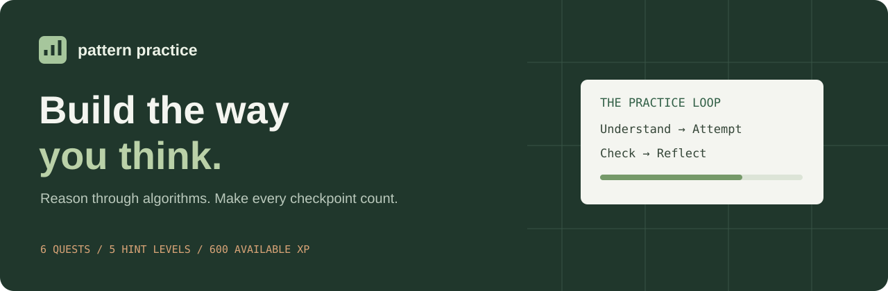
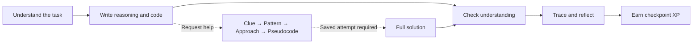
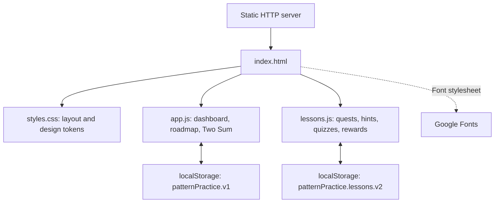

<div align="center">



# Pattern Practice

### Turn algorithm practice into a sequence of small wins.

A browser-based interview practice workspace with guided reasoning, progressive hints, Python exercises, and checkpoint-based rewards.

[](https://github.com/Skeeb32/code/stargazers)
[](https://github.com/Skeeb32/code/forks)
[](https://github.com/Skeeb32/code/commits/main)
[](https://github.com/Skeeb32/code/issues)

[**Get started**](#quick-start) · [**Explore the quests**](#the-quest-library) · [**Under the hood**](#architecture) · [**Contribute**](#contributing)

</div>

---

## The idea

Solving an interview problem involves more than producing code. You need to understand the input, recognize a pattern, choose a strategy, and explain why it works.

**Pattern Practice makes that reasoning visible.** Write an approach, attempt a solution, request help one step at a time, and reflect on complexity. Each quest turns those actions into a visible success meter and XP.

The current experience is a static learning app with prepared content. It runs in your browser without an account, API key, package installation, or build step.

| Learn | Practice | See progress |
| :--- | :--- | :--- |
| A six-stage, 12-week curriculum outline | Six original algorithm quests plus a separate Two Sum lesson | Individual quest success meters |
| Five progressively detailed hints per quest | Python attempt and reasoning fields | Up to 600 XP, five reachable levels, four badges |
| Worked solutions and complexity notes | A multiple-choice check and written reflection | Browser-local saving across visits |

> **What “success” means:** meters track completed learning checkpoints. Python submissions are saved as text; the app does not execute or grade them. Quiz answers are checked against prepared answers.

## See the learning loop



The interface pairs a sage-and-cream dashboard with a dark code workspace. The **Algorithm quests** view adds selectable lesson cards, progress bars, and a badge row. The banner above is a project illustration, not an application screenshot.

### Try a quest in two minutes

1. [Run the app locally](#quick-start), then choose **Algorithm quests** in the sidebar.
2. Open **Hash sets** and acknowledge the requirements.
3. Write your reasoning and a Python attempt, then select **Save attempt**.
4. Request hints only when needed; each click reveals one additional level.
5. Answer the quiz and save a walkthrough with a complexity explanation.
6. Refresh the page and reopen the quest to see your saved work.

## The quest library

These six exercises are original practice challenges. The separate **Practice** view contains the introductory Two Sum lesson linked to LeetCode.

| Quest | Challenge | Reasoning focus |
| :--- | :--- | :--- |
| **Hash sets** | Detect duplicate integers | Remember visited values; trade space for faster lookup |
| **Two pointers** | Find whether a sorted list contains a target pair | Eliminate candidates using sorted order |
| **Binary search** | Find a target index or return `-1` | Maintain bounds and guarantee progress |
| **Sliding window** | Find the largest sum of `k` consecutive values | Reuse work shared by adjacent windows |
| **Stack matching** | Validate a string of parentheses | Track unmatched openings |
| **Dynamic programming** | Count ways to climb using jumps of one or two | Reuse answers to overlapping subproblems |

Each quest includes a problem statement, example, reasoning field, code field, five hints, one quiz question, and a reflection prompt. The final hint includes Python code and a complexity explanation.

## Gamification with a clear scorecard

Each quest offers **100 XP**, earned once per checkpoint. Repeating a completed action does not increase its score.

| Checkpoint | XP | Current requirement |
| :--- | ---: | :--- |
| Understand | 20 | Acknowledge the requirements |
| Attempt | 25 | Save nonempty reasoning and code |
| Check | 35 | Choose the correct quiz answer |
| Reflect | 20 | Save an attempt first, then a reflection of at least 30 trimmed characters |

**Level = `1 + floor(total XP / 150)`** — six quests provide a maximum of 600 XP and level 5.

| Badge | Unlock condition |
| :--- | :--- |
| ★ First step | Earn at least 20 XP |
| ★ First quest | Complete one quest at 100% |
| ★ Pattern explorer | Complete three quests |
| ★ Six-pattern finisher | Complete all six |

The quest scores are separate from the original Two Sum/dashboard progress. Text length and saved attempts are participation checks, not assessments of solution quality.

## Architecture




| File | Responsibility |
| :--- | :--- |
| [`index.html`](index.html) | Application shell, navigation, dashboard, roadmap container, and Two Sum panels |
| [`styles.css`](styles.css) | Color and typography tokens, Grid/Flexbox layouts, mobile rules, focus styling, and reduced-motion rules |
| [`app.js`](app.js) | Original view navigation, lesson steps, roadmap rendering, and saved Two Sum state |
| [`lessons.js`](lessons.js) | Six exercise definitions, quest rendering, checkpoint scoring, hints, quizzes, and persistence |
| [`docs/assets/hero.svg`](docs/assets/hero.svg) | Repository-owned README artwork |

**Engineering decisions worth exploring:**

- **Browser-native implementation.** Direct DOM updates and event handlers keep the application free of framework and package dependencies.
- **Derived rewards.** Scores are computed from checkpoint flags, avoiding repeated XP awards for the same action.
- **Progressive disclosure.** The fifth hint requires a saved attempt, encouraging an initial effort before the full solution appears in the UI.
- **Local persistence.** Reasoning, code, hints, and quest flags are saved with `localStorage`. Storage access is guarded with `try/catch`.
- **Escaped user text.** Quest notes and code are escaped before insertion into HTML templates.
- **Responsive foundations.** CSS includes adaptive layouts, visible focus outlines, and reduced-motion overrides. These are implementation features, not a claim of a completed accessibility audit.

Python is the language used in the exercise content. JavaScript runs the application. Google Fonts supplies typography; the CSS includes system fallbacks.

## Quick start

### 1. Prerequisites

Install **Git** and **Python 3**, and use a modern browser with JavaScript enabled. Node.js is optional for syntax checks.

### 2. Clone and run

```sh
git clone https://github.com/Skeeb32/code.git
cd code
python3 -m http.server 8000 --bind 127.0.0.1
```

On Windows, if `python3` is unavailable:

```powershell
py -m http.server 8000 --bind 127.0.0.1
```

Open **[http://localhost:8000](http://localhost:8000)**. Stop the server with `Ctrl+C`.

### 3. Configuration

There is no package installation, `.env` file, API key, database, or compilation step. Serve the repository root so relative CSS and script paths resolve correctly.

Use the same hostname and port to retain access to saved progress. Browser storage is scoped to the origin: `localhost:8000`, `127.0.0.1:8000`, and a deployed domain each have separate data. Clearing site data removes progress; private browsing may not retain it.

### 4. Checks before a pull request

With Node.js installed, check JavaScript syntax:

```sh
node --check app.js
node --check lessons.js
```

These commands check parsing, not application behavior. The repository currently has no automated test suite, CI workflow, or coverage report.

For a manual smoke check:

- Navigate between Overview, Roadmap, Practice, and Algorithm quests.
- Complete a quest checkpoint twice and confirm XP is awarded only once.
- Submit an incorrect quiz option, then the correct one; confirm only the correct response awards XP.
- Request the fifth hint before saving an attempt; confirm the solution stays hidden. Save an attempt and request it again.
- Refresh and reopen a quest; confirm notes, code, and rewards persist.
- Check the layout at narrow and wide widths, keyboard navigation, and the browser console.

### 5. Static deployment

Upload the repository's static files together, preserving their relative paths. No build command or generated output directory is required.

For GitHub Pages, a repository administrator can select **Settings → Pages → Deploy from a branch**, then choose `main` and `/ (root)`. Use the published URL shown by GitHub after deployment completes. This README does not assume a live deployment is configured.

## Project status and boundaries

This is an early learning-app implementation with **six original quests, one introductory Two Sum lesson, four badges, and no package dependencies**. The badges above report live repository activity through Shields.io; they are not usage analytics.

A few details matter when evaluating or extending the project:

- The 12-week roadmap outlines future learning topics; it is not a fully implemented 12-week course.
- There is no live AI coach, Python runner, automatic code review, account system, or cross-device synchronization.
- The dashboard date, streak, and assessment labels are currently static presentation content.
- Two Sum and quest progress use separate state models. Dashboard completion is not an aggregate mastery score.
- Hints and answers are shipped in client-side source. The solution gate is a learning aid, not an access-control boundary.
- No license file is currently included. Public visibility does not itself grant an open-source license; clarify licensing with the maintainer before redistribution.

## Roadmap

**Available today**

- [x] Dashboard and six-stage curriculum outline
- [x] Guided Two Sum introduction
- [x] Six original algorithm quests with Python solutions
- [x] Five-level hint progression
- [x] Success meters, XP, levels, and achievement badges
- [x] Browser-local saving

**Proposed next steps — contributions welcome**

- [ ] Unify dashboard, lesson, and quest progress
- [ ] Add trees, BFS/DFS, heaps, and backtracking exercises
- [ ] Add automated browser tests and CI
- [ ] Improve keyboard focus handling and complete an accessibility review
- [ ] Add progress export/import and a real activity streak
- [ ] Explore safely isolated Python execution and test-case feedback
- [ ] Define licensing and contribution policies

## Contributing

Good contributions can improve the learning experience as much as the implementation. Bring an edge case, a clearer explanation, an accessible interaction, or a new exercise.

1. [Open an issue](https://github.com/Skeeb32/code/issues/new) for a substantial change so the intended behavior is clear.
2. [Fork the repository](https://github.com/Skeeb32/code/fork), clone your fork, and create a focused branch:

   ```sh
   git switch -c feat/your-change
   ```

3. Follow the [quick start](#quick-start). Make your change and run the relevant syntax and manual checks.
4. Open a pull request describing the problem, the behavior after the change, and how you checked it. Include screenshots for interface changes.

**Adding an exercise?** Follow the lesson records in `lessons.js`: title, pattern, task, example, hint, approach, Python solution, complexity explanation, quiz options, and correct answer index. The pseudocode lookup and several six-quest totals are currently hardcoded; update those alongside new lessons and check badge thresholds. Label original exercises clearly and verify any external problem attribution.

Keep changes focused, escape user-controlled text before rendering HTML, and preserve existing saved work when changing the storage schema.

## For engineers and recruiters

This repository demonstrates how a small frontend can translate a learning workflow into concrete interactions: progressive hints, form state, quiz feedback, persistence, and rewards derived from completed checkpoints.

For a short code tour, start with **`score` and `reward` in `lessons.js`** to inspect repeat-safe scoring, then review **`renderWork`** for input handling, escaping, and hint progression. Compare the storage and navigation models in **`app.js`** and **`lessons.js`** to see the next refactoring opportunity. Finish with **`styles.css`** for the visual system and responsive rules.

The project showcases vanilla JavaScript, DOM event handling, browser storage, responsive CSS, and algorithm explanation. Its next engineering milestones are unified state, behavior tests, and stronger accessibility verification.

Built by [Skeeb32](https://github.com/Skeeb32).

---

<div align="center">

### Help make the next practice session better.

**[⭐ Star the project](https://github.com/Skeeb32/code)** if the idea resonates.  
**[Fork it](https://github.com/Skeeb32/code/fork)** to build your own learning workspace.  
**[Open an issue](https://github.com/Skeeb32/code/issues/new)** with a bug, an exercise, or a better explanation.

Learn the pattern. Explain the reasoning. Keep building.

</div>
